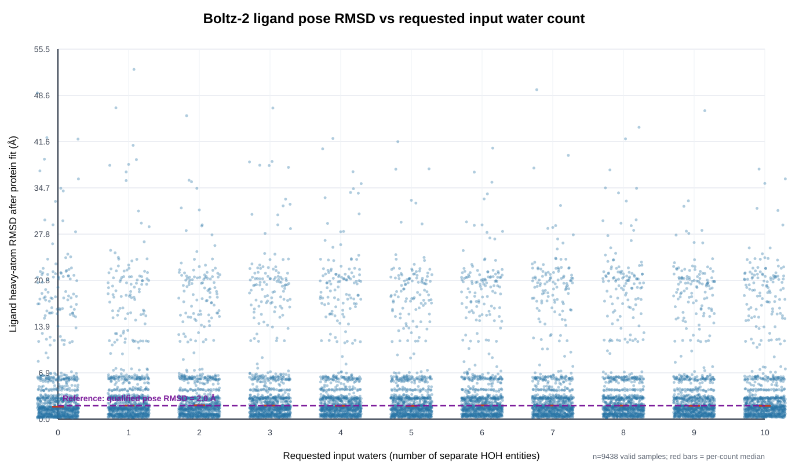
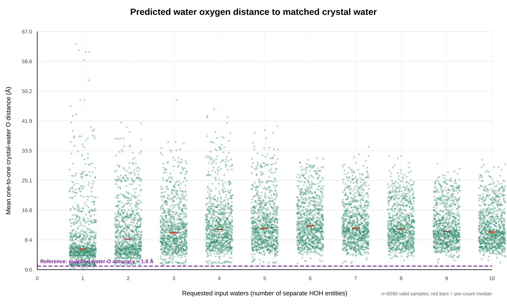

# Boltz-2 输入水分子数量梯度基准

显式请求 1–10 个 CCD 水分子对配体构象预测与晶体水氧复现的影响。
执行日期 2026-10-10（Asia/Shanghai）；服务器 `compute-node`（8× RTX 5090 32 GB）。

## 结论摘要

- **配体构象与请求水数量无关。** 受体叠合后的配体重原子 RMSD，各水数量下中位数稳定在 **1.98–2.07 Å**、均值 4.50–4.84 Å，无单调趋势（图 1、表 1）。总体 49.8% 样本 RMSD<2 Å，分布重尾（P90≈16.6 Å）。
- **预测水氧几乎不落在晶体水位点上。** 一对一匹配 F1（2.0 Å）随请求水数由 **0.019** 升到 **0.036**（precision 0.113→0.036，recall 0.011→0.040），预测水氧到配对晶体水的平均距离 **9.3–13.7 Å**（图 2、表 1）。
- **该结论不由少数大复合物驱动。** 剔除 3 个 4 链大目标后水氧指标趋势不变；即使只保留构象正确（RMSD<2 Å）的样本，F1（2.0 Å）仍仅 0.010–0.031（第 5 节）。
- **与合格基线对比：** 配体 RMSD 中位数（≈2.0 Å）恰在合格姿态线 2.0 Å 上，但上缘重尾远超；预测水氧一对一距离（9–14 Å）比合格水位点精度（~1.0 Å）高约一个数量级（图 1、图 2 紫色虚线；来源见 2.4）。

| 指标 | 值 |
| --- | --- |
| 已完成任务 | 300/300 job |
| 有效样本 | 8580 |
| 配体 RMSD 中位数 | 2.01 Å |
| 水氧 F1@2.0 Å（1→10 水） | 0.019→0.036 |

## 1 · 数据与输入构造（是否泄漏原生坐标）

程序在**推理前**把用户提供的 mmCIF 拆成"蛋白/配体/水"，并把"模型输入"与"仅用于打分的信息"严格分开。以 `1FIN` 为例提交给 Boltz 的 YAML 只含序列、配体 SMILES 与 N 个 HOH 实体：

```
version: 1
sequences:
  - protein: {id: A, sequence: <实体1 单字母序列>}   # 蛋白：仅序列(+标准MSA)
  - protein: {id: B, sequence: <实体2 单字母序列>}
  - ligand:  {id: LIG, smiles: "<官方 SMILES_CANONICAL>"}  # 配体：仅化学式
  - ligand:  {id: W01, ccd: HOH}                     # 水：仅 CCD 代码
  - ligand:  {id: W02, ccd: HOH}
  ...                                                # 共 N 个独立 HOH 实体
```

| 类别 | 识别方式 | 进入模型输入？ | 用途 |
| --- | --- | --- | --- |
| 蛋白链 | `_entity_poly.type=polypeptide` 的全部不对称单元链序列 | 仅序列(+MSA) | 折叠 |
| 目标配体 | 匹配目标 CCD 的残基，确定性选唯一副本 | 仅官方 SMILES_CANONICAL | 折叠 |
| 水分子 | 残基名 `HOH/WAT/DOD`，每残基取占据最高氧 | **否** | 定义参考水壳/打分/可视化 |
| 原生坐标 | 晶体蛋白/配体/水坐标 | **否**（无坐标/模板/口袋约束） | 仅推理后评估 |

**不泄漏论证：** 模型输入不含任何晶体坐标、坐标模板、口袋约束或原生水位点；配体只给 SMILES，水只给 CCD 代码。原生结构只在推理结束后用于定义 6 Å 参考水壳、配体 RMSD 与配对可视化，不存在把答案喂给模型的路径。

## 2 · 指标定义与公式

### 2.1 配体 RMSD（按受体叠合）

先用蛋白共同 Cα 做 Kabsch 刚体叠合，再对配体做对称性感知的最小重原子 RMSD：

```
RMSD = min_{π∈自同构} sqrt( (1/M) Σ_i || (R·p_i + t) − q_{π(i)} ||² )
```
同时报告 median 与 frac(RMSD<2 Å)：均值受少数错误 pose（P90≈16.6 Å）放大，中位数反映典型准确度。

### 2.2 水氧匹配（集合→集合的最优一对一）

- 原生水集合 **N**：距原生配体 6 Å 内的晶体水，每残基取占据最高的一个氧（平均 7.08 个/样本）。不是"模板最近水"单点。
- 预测水集合 **P**：模型输出的 HOH 氧原子（请求 N 个水即输出 N 个氧，平均 5.50 个/样本）。

构造距离矩阵 `D_ij = ||p_i − n_j||`，用**匈牙利算法**（Kuhn–Munkres / `scipy.optimize.linear_sum_assignment`）求**一对一**最优指派（一个预测水最多对应一个原生水，反之亦然）：

```
一对一平均配对距离 = mean_{ (i,j)∈最优指派 } D_ij            （无阈值：表1末列 / 图2）
给定阈值 τ ∈ {1.0, 1.5, 2.0} Å：
  代价 c_ij = D_ij (若 D_ij ≤ τ) 否则 1e6
  σ = argmin Σ c_ij ；命中 = { (i,j)∈σ : D_ij ≤ τ }
  precision = 命中数 / |P|
  recall    = 命中数 / |N|
  F1        = 2·precision·recall / (precision + recall)
```

**阈值约定：** 1.5 Å 为"同一水位点"的常用判据，1.0 Å 严格、2.0 Å 宽松；三档并列，主口径取 2.0 Å。precision 的"阳性"即"预测水氧在 τ 内找到唯一对应的真实水氧"。

### 2.3 为何用一对一最优指派（而非最近邻）

- 水是无序点集，需"预测↔真实"对应才能定义命中；**最近邻会重复计数**（同一预测水被多个真实水各自算命中），precision 虚高且不可加。
- 匈牙利算法给出全局最优的**严格一对一**指派，是集合对应问题的标准最优解；precision/recall/F1 是标准报告方式，能同时暴露"乱放"（precision 低）与"漏放"（recall 低）。
- 以梯度式阈值替代单阈值，避免结论对容差敏感。

### 2.4 参考基线（两图紫色虚线）

- **配体姿态 2.0 Å**：重原子 RMSD ≤ 2.0 Å 是对接/共折叠领域的通用"成功"判据（DOCK/CSAR 基准、Uni-Mol Docking V2、PoseBusters/PoseBench 等），1.0 Å 为高精度。
- **水位点 ~1.0 Å**：合格水位点预测器平均误差在亚 Å 量级——WaterDock 对 consensus 水位点平均误差 ≈0.78 Å（判据 1.5 Å），SuperWater 定位精度 ≈0.3±0.06 Å（判据 1.0/0.5 Å）。取 1.0 Å 作保守"合格"线。

来源：Sridhar et al., PLOS ONE 2012（WaterDock；WaterDock 2.0, 2017）；SuperWater, Communications Chemistry 2025；Wierbowski et al., Protein Science 2020；Uni-Mol Docking V2, arXiv 2024。两图均以紫色虚线画出基线。

## 3 · 数据完整性（8580 / 9000 缺了什么）

设计 30 目标 × 10 水数量 × 30 重复 = 9000；实得 **8580**，缺口 **420 = 3 目标 × 10 水数量 × 14 重复**。

- 缺失者为 `1FIN`、`2HYY`、`3CS9`（4 链、约 1100 token），30 重复下峰值约 33.6 GB，超过 32 GB，确定性 OOM。
- **不是缺整条梯度**：这 3 个目标的**水数量 1–10 全部都有**，只是每个梯度的**重复数由 30 降为 16**（少 14 个重复）。其余 27 个目标为完整 30 重复。
- 每任务实际重复数写入 `status.requested_samples` 与 `source_completeness.json` 的 `job_sample_counts`，评估/汇总按各任务自身重复数统计，无静默替换。
- 这 3 个目标样本仅占 480/8580 = 5.6%，且第 5 节显示剔除后趋势不变。

## 4 · 结果



**图 1（主图）** 受体叠合后的配体 RMSD vs 请求水数量。每点为一个有效样本（池化全部 30 目标），横轴按目标微抖动，红横为各水数量**中位数**。各列中位线几乎水平（≈2.0 Å）；上缘重尾由少数较大/多链目标贡献——故配体准确度看中位数，且不随水数量变化。**紫色虚线 = 合格姿态判定线 2.0 Å**（重原子 RMSD，对接/共折叠通用成功阈值）；本模型中位数恰在线上，上缘重尾远超（最大 52.5 Å）。

### 表 1 · 按请求水数量汇总（t 均值；RMSD 给均值/中位）

| 请求水数 | 有效样本 | 配体 RMSD 均值/中位 (Å) | RMSD<2 Å 占比 | F1@1.0 | F1@1.5 | F1@2.0 | prec@2.0 | recall@2.0 | 一对一水氧距离 (Å) |
| --- | --- | --- | --- | --- | --- | --- | --- | --- | --- |
| 1 | 858 | 4.53 / 2.03 | 0.494 | 0.003 | 0.014 | 0.019 | 0.113 | 0.011 | 9.31 |
| 2 | 858 | 4.53 / 2.07 | 0.491 | 0.005 | 0.017 | 0.028 | 0.083 | 0.017 | 11.10 |
| 3 | 858 | 4.76 / 2.03 | 0.497 | 0.008 | 0.021 | 0.032 | 0.068 | 0.022 | 11.98 |
| 4 | 858 | 4.72 / 2.00 | 0.501 | 0.006 | 0.021 | 0.033 | 0.057 | 0.026 | 13.08 |
| 5 | 858 | 4.50 / 1.98 | 0.505 | 0.006 | 0.021 | 0.035 | 0.053 | 0.029 | 13.25 |
| 6 | 858 | 4.75 / 2.06 | 0.491 | 0.008 | 0.022 | 0.034 | 0.046 | 0.030 | 13.66 |
| 7 | 858 | 4.71 / 2.03 | 0.493 | 0.008 | 0.023 | 0.034 | 0.043 | 0.031 | 13.13 |
| 8 | 858 | 4.84 / 2.02 | 0.498 | 0.008 | 0.025 | 0.037 | 0.041 | 0.038 | 12.67 |
| 9 | 858 | 4.71 / 1.98 | 0.505 | 0.008 | 0.022 | 0.036 | 0.039 | 0.039 | 12.35 |
| 10 | 858 | 4.70 / 1.98 | 0.505 | 0.008 | 0.022 | 0.036 | 0.036 | 0.040 | 12.19 |

水数量 1→10：配体 RMSD 中位数几乎不变；水氧 F1 仅 0.019→0.036，precision 下降、recall 上升——请求更多水主要摊薄 precision。



**图 2（主图）** 预测水氧与晶体水的一对一平均配对距离（无阈值最优指派，越小越好）vs 请求水数量。纵轴始终在 **9–14 Å** 量级且不下降；1–6 水时距离上升后趋平——水氧被"摊开"而非收敛到晶体水。与表 1 的 F1 互补：F1 表"命中率极低"，本图表"即使不命中，距离也普遍很远"。**紫色虚线 = 合格水位点精度 ~1.0 Å**（WaterDock 平均误差≈0.78 Å、SuperWater≈0.3 Å）；本模型纵轴比合格线高约一个数量级。

### 表 2 · 按目标汇总（配体 RMSD）

| 目标 | 样本 | 均值 (Å) | 中位 (Å) | RMSD<2 Å 占比 |
| --- | --- | --- | --- | --- |
| 11ES | 300 | 0.77 | 0.73 | 1.000 |
| 12EW | 300 | 2.73 | 2.50 | 0.180 |
| 36CA | 300 | 20.94 | 21.11 | 0.000 |
| 31LQ | 300 | 3.16 | 3.16 | 0.000 |
| 1IEP | 300 | 13.42 | 13.70 | 0.000 |
| 1M17 | 300 | 4.39 | 4.39 | 0.000 |
| 2HYY * | 160 | 22.15 | 20.29 | 0.000 |
| 3CS9 * | 160 | 21.45 | 20.36 | 0.000 |
| 2ITY | 300 | 1.54 | 1.54 | 0.993 |
| 2ITN | 300 | 1.96 | 1.91 | 0.573 |
| 2ITO | 300 | 0.85 | 0.82 | 1.000 |
| 2ITP | 300 | 1.20 | 1.22 | 0.997 |
| 2ITQ | 300 | 0.55 | 0.56 | 1.000 |
| 2ITT | 300 | 1.42 | 1.44 | 1.000 |
| 2ITU | 300 | 3.05 | 3.05 | 0.000 |
| 2ITV | 300 | 1.69 | 1.62 | 0.857 |
| 2ITW | 300 | 3.16 | 3.11 | 0.000 |
| 2ITX | 300 | 1.97 | 1.95 | 0.567 |
| 2ITZ | 300 | 0.88 | 0.82 | 0.997 |
| 4X0M | 300 | 0.40 | 0.37 | 0.990 |
| 4X2F | 300 | 4.21 | 5.95 | 0.190 |
| 4X2G | 300 | 0.66 | 0.60 | 0.990 |
| 4X2J | 300 | 2.16 | 0.53 | 0.547 |
| 4X2K | 300 | 3.48 | 6.17 | 0.480 |
| 1YWN | 300 | 1.84 | 1.84 | 0.997 |
| 1FIN * | 160 | 20.13 | 17.45 | 0.000 |
| 4AGD | 300 | 1.84 | 1.88 | 0.610 |
| 10OT | 300 | 5.69 | 5.84 | 0.000 |
| 28JH | 300 | 12.96 | 7.10 | 0.000 |
| 30GX | 300 | 2.75 | 2.84 | 0.270 |

`*` 4 链大复合物，受显存限制以 16 重复运行。

## 5 · 混杂因素与稳健性：结论是否由少数大复合物驱动？

| 数据集 | 样本 | RMSD 均值 | RMSD 中位 | RMSD<2 | 水氧 F1@2.0（1/5/10 水） | 一对一距离（1/5/10 水） |
| --- | --- | --- | --- | --- | --- | --- |
| 全部 30 目标 | 8580 | 4.67 | 2.01 | 0.498 | 0.019 / 0.035 / 0.036 | 9.31 / 13.25 / 12.19 |
| 剔除 3 个多链目标 | 8100 | 3.69 | 1.89 | 0.527 | 0.021 / 0.037 / 0.038 | 8.38 / 12.41 / 11.56 |
| **仅 RMSD<2 Å 样本** | 4271 | 1.09 | 1.10 | 1.000 | **0.010 / 0.031 / 0.029** | **7.29 / 11.51 / 10.57** |

- **配体 RMSD：** 剔除 3 个目标后均值 4.67→3.69 Å、中位 2.01→1.89 Å；均值确被大目标抬高，但中位数与 frac<2 及随水数量的趋势不变——结论稳健。
- **水氧指标：** 剔除 3 个目标后变化极小，趋势一致。
- **最强证据：** 只保留"受体+配体都正确（RMSD<2 Å）"的 4271 个样本时，水氧 F1（2.0 Å）仍仅 0.010–0.031、平均配对距离仍 7.3–11.5 Å——排除折叠失败混杂后，模型仍无法把水氧放到晶体水位点，说明水氧结论是模型的系统性行为，而非大复合物伪影。

## 6 · 边界与局限

- 盲预测：不传坐标/模板/口袋约束；配体 RMSD 在共同 Cα 叠合后测得。
- MSA 由标准服务生成并按 Boltz 默认（`--subsample_msa`、`--num_subsampled_msa 1024`）处理；同一目标不同水数量共享同一 MSA。
- 参考水壳取 6 Å；水氧匹配对 1.0/1.5/2.0 Å 三档给出。未计算亲和力（官方亲和力模块不显式处理水）。
- 3 个多链目标以 16 重复运行，已在指标与清单中显式标注。

## 7 · 交付物与校验

服务器 `/path/to/boltz-water-benchmark/`，同步到本地 `results/water-gradient-benchmark/`：

- `deliverables/production/`：`summary_by_water_count.csv`、`summary_by_target_water.csv`、`scatter_coordinates.csv`、`ligand_rmsd_scatter.svg`、`water_position_scatter.svg`、`source_completeness.json`、`release_manifest.json`、`paired_reference_boltz_pdbs.zip`（8580 配对 PDB）、`source_data_and_metrics.zip`。
- `metrics/production/`：`sample_metrics.csv`（逐样本 8580 行）、`evaluation_summary.json`。
- `provenance/`：`manifest.json`、`prepared_manifest.json`、`run_config.json`、`run_summary.json`。

配对 PDB 采用**单模型**布局：参考用大写链（蛋白 `A,B,..`、配体 `L`、晶体水 `N`），Boltz 预测用小写链（蛋白 `a,b,..`、配体 `l`、输入水 `n`），预测已按蛋白 Cα 叠合到参考坐标系，因此打开文件即叠加；隐藏大写链即只显示 Boltz 预测。

| 归档 | SHA-256 |
| --- | --- |
| paired_reference_boltz_pdbs.zip | 26e15b0f15bbea4f92185c714b9c7a7502ce43b56662b148ed10807f0f5cb2c8 |
| source_data_and_metrics.zip | aab9ff5e338d6730ecdfadcda8058e432b6038d1ae32cb5c0997cfb820067573 |

发布清单自检：`design_complete=true`，`release_complete=true`，300/300 任务在册，8580 行指标全部 `ok`，缺失/失败/路径不一致均为 0。

## 8 · 复现

服务器 `boltz` 环境：`code/prepare.py` → `code/run_grid.py`（或续跑 `code/run_retry.py`）→ `code/evaluate.py` → `code/summarize.py`。关键设置：`--model boltz2 --diffusion_samples 30 --max_parallel_samples 1 --seed SEED_BASE+target*1000+water --use_msa_server`；3 个大目标改用 `--diffusion_samples 16`。评估/汇总按各任务自身记录的样本数工作。
